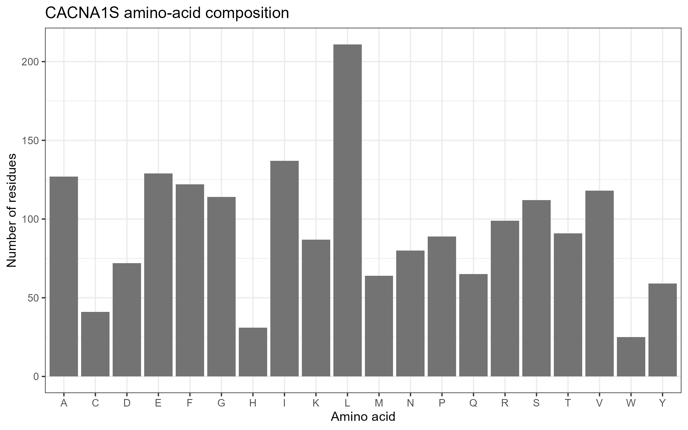
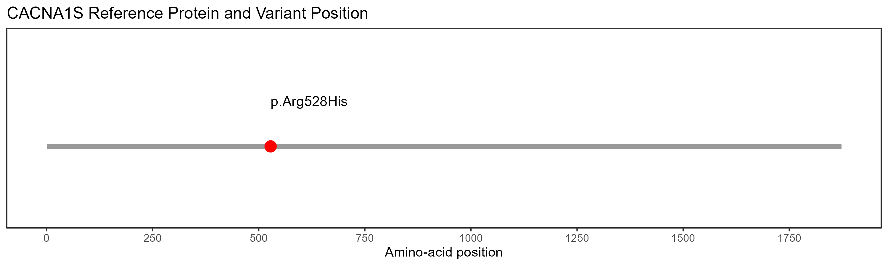

# Molecular Mechanisms of Muscle Contractility: CACNA1S Variant Analysis

## Student Information

- **Student Number:** 202400735

## Project Information

- **Assignment Number:** 25
- **Gene:** CACNA1S
- **NCBI Gene ID:** 779
- **Transcript Accession:** NM_000069.3
- **Protein Accession:** NP_000060.2
- **ClinVar Variation ID:** 17625
- **Assigned Variant:** c.1583G>A (p.Arg528His ; R528H)
- **Associated Condition:** Hypokalemic periodic paralysis type 1
- **ClinVar Classification:** Pathogenic

## Research Question

What is the normal role of CACNA1S in skeletal muscle, and what is known about the molecular and clinical effects of the p.Arg528His variant?

This project retrieves the reference protein sequence, analyzes its amino-acid composition, visualizes the variant position, and reviews published evidence concerning its possible effects on muscle excitation–contraction coupling.

## Introduction

The CACNA1S gene encodes the alpha-1S subunit of the voltage-gated L-type calcium channel CaV1.1, which is essential for skeletal muscle contraction. When a muscle receives an electrical signal, CaV1.1 acts as a voltage sensor in the muscle membrane and communicates with the ryanodine receptor (RYR1). This interaction triggers the release of calcium from the sarcoplasmic reticulum. Calcium then binds to troponin, allowing actin and myosin to interact and generate muscle contraction.

The variant investigated in this project, c.1583G>A (p.Arg528His), involves a change in the CACNA1S protein at amino-acid position 528, where arginine is replaced by histidine. This is known as a missense variant. According to ClinVar, the variant is classified as pathogenic and is associated with hypokalemic periodic paralysis type 1, a condition in which individuals experience episodes of muscle weakness, often associated with low potassium levels in the blood.

To better understand this variant, the project examines the reference CACNA1S protein sequence and its amino-acid composition, then identifies and visualizes the position of the change. It also reviews published evidence to explore how the variant may affect the normal function of skeletal muscle.


## Methods

### Step 1. Software, Packages, and Project Setup

The analysis was conducted using R in RStudio. The `rentrez` package was used to retrieve gene and protein records from the National Center for Biotechnology Information (NCBI), while `ggplot2` was used to generate the graphical visualizations. The packages were loaded into the R environment, and variables were defined for the gene symbol, reference transcript, ClinVar Variation ID, and assigned protein variant. 

**Code Used:**

```r
library(rentrez)
library(ggplot2)

gene_symbol <- "CACNA1S"
transcript_accession <- "NM_000069.3"
clinvar_id <- "17625"
variant_protein <- "p.Arg528His"
```

The project directories `data/`, `results/`, and `figures/` were created using R's `dir.create()` function within a `for` loop. The folder names were stored in a character vector, allowing the script to create all three directories automatically. The argument `showWarnings = FALSE` suppressed warnings if a directory already existed. This organization separated the downloaded reference protein sequence, generated result files, and graphical outputs.

**Code Used:**
```r
for (x in c("data", "results", "figures")) {
  dir.create(x, showWarnings = FALSE)
}
```

### Step 2. Retrieval and Verification of CACNA1S Gene Information

The human CACNA1S gene record was retrieved from the NCBI Gene database using the `entrez_search()` function from the `rentrez` package. The search used the gene symbol and the Gene Name field, with results restricted to humans using the taxonomy ID `txid9606`. A maximum of 20 records was requested to identify the correct gene.

The returned gene IDs were then examined individually using `entrez_summary()`. Each record's name was compared with the assigned gene symbol, regardless of capitalization, to ensure that the selected record corresponded to CACNA1S. If no records were found or no exact gene-symbol match was identified, the script stopped and displayed an error message.

After confirming the correct record, the script extracted the gene symbol, NCBI Gene ID, official gene name, and chromosome assignment. A brief description of the gene's normal role in skeletal muscle and the NCBI Gene source URL were also included. The results were saved to `results/gene_summary.txt`.

**Code Used:**

```r
hits <- entrez_search(
  db = "gene",
  term = paste0(
    gene_symbol,
    "[Gene Name] AND txid9606[Organism]"
  ),
  retmax = 20
)

rec <- entrez_summary(db = "gene", id = id)

if (toupper(rec$name) == toupper(gene_symbol)) {
  gene_id <- id
  gene_info <- rec
  break
}
```

The retrieved record identified CACNA1S as NCBI Gene ID **779**, with the official name *calcium voltage-gated channel subunit alpha1 S*. The resulting summary was used to document the gene's identity and its reported role in skeletal muscle excitation–contraction coupling.

### Step 3. Retrieval of the Reference Protein Sequence

The reference transcript `NM_000069.3` was retrieved from the NCBI Nucleotide database using `entrez_fetch()` in GenBank format. A regular expression was used to find the matching protein accession, `NP_000060.2`, from the transcript record. The corresponding protein sequence was then retrieved from the NCBI Protein database in FASTA format. The script checked whether the retrieved record had a valid FASTA header before saving the sequence to `data/CACNA1S_protein.fasta`. The protein accession was also saved in `results/protein_accession.txt`.


**Code Used:**

```r
gb <- entrez_fetch(
  db = "nuccore",
  id = transcript_accession,
  rettype = "gb",
  retmode = "text"
)

pat <- '/protein_id="NP_[0-9]+[.][0-9]+"'
fragment <- regmatches(gb, regexpr(pat, gb))

protein_accession <- gsub(
  '^/protein_id="|"$',
  '',
  fragment
)
```

The protein sequence was subsequently retrieved using the extracted accession:

```r
protein_fasta <- entrez_fetch(
  db = "protein",
  id = protein_accession,
  rettype = "fasta",
  retmode = "text"
)
```

The resulting accession was **NP_000060.2**. The saved FASTA file was used as the common reference input for the amino-acid composition analysis and variant-position visualization.

### Step 4. Analysis of Protein Length and Amino-Acid Composition

The saved FASTA file was first imported into R using `readLines()`. Since the header contains information about the sequence rather than the actual protein residues, it was removed by selecting only the lines that did not begin with `>`. The remaining lines were then joined together into one continuous character string.

Next, the cleaned sequence was split into individual amino-acid residues using `strsplit()`. Counting these residues gave the total length of the protein. To examine its composition, the 20 standard amino acids were defined using their one-letter codes, and the `factor()` and `table()` functions were used to count how often each one appeared. By specifying all 20 amino acids as factor levels, the resulting table included every standard amino acid, even those that did not occur in the sequence and therefore had a count of zero.

The counts were then arranged into a data frame with two columns: the amino-acid code and its corresponding frequency. Finally, the table was exported to `results/amino_acid_composition.csv` using `write.csv()` with `row.names = FALSE`. This kept the output clean by preventing R from adding an extra column containing row numbers.

**Code Used:**

```r
sequence <- paste(
  fasta_lines[!grepl("^>", fasta_lines)],
  collapse = ""
)

sequence <- toupper(gsub("\\s+", "", sequence))
aa <- strsplit(sequence, "")[[1]]

protein_length <- length(aa)

standard <- strsplit(
  "ACDEFGHIKLMNPQRSTVWY", ""
)[[1]]

counts <- table(factor(aa, levels = standard))
```

The resulting frequency table was used to identify the most and least abundant amino acids. 

### Step 5. Visualization of Amino-Acid Composition

The amino-acid frequency table was used to create a bar chart in `ggplot2`, making it easier to compare how often each amino acid appears in the protein sequence. The amino-acid codes were placed along the horizontal axis, while their corresponding counts were shown on the vertical axis. Using `geom_col()`, the chart displayed the observed frequencies as bars. The `theme_bw()` function gave the plot a clean, white-background appearance. A title containing the gene symbol was added, along with axis labels to identify the amino-acid categories and their residue counts.

**Code Used:**

```r
fig1 <- ggplot(results, aes(AminoAcid, Count)) +
  geom_col(fill = "grey45") +
  theme_bw() +
  labs(
    title = paste(gene_symbol, "amino-acid composition"),
    x = "Amino acid",
    y = "Number of residues"
  )
```

The figure was exported as `figures/01_amino_acid_composition.png` using `ggsave()`. The resulting figure provided a visual comparison of the frequencies of the 20 standard amino acids in the CACNA1S reference protein.

### Step 6. Visualization of the Assigned Variant Position

**Option A** was selected to visualize the assigned missense variant, **p.Arg528His**, because it provided a clear representation of the variant's position within the reference protein. The variant was mapped to amino-acid position **528** of the **1,873-amino-acid** reference protein.

To verify that the assigned residue was valid, `stopifnot()` was used to confirm that position 528 fell within the reference protein sequence before generating the figure.

**Code Used:**

```r
variant_protein <- "p.Arg528His"
position <- 528

stopifnot(
  position >= 1,
  position <= protein_length
)
```

The variant marker and full-length protein line were generated using:

```r
geom_segment(
  aes(x = 1, xend = protein_length, y = 0, yend = 0),
  linewidth = 2,
  color = "grey60"
) +
geom_point(
  aes(x = position, y = 0),
  size = 4,
  color = "red"
)
```

The completed figure was saved as `figures/02_variant_position.png` at **300 dpi**. It illustrated the location of residue 528 within the reference protein but did not directly demonstrate the structural or functional effects of the amino-acid substitution.

### Step 7. Manual Review of the ClinVar Variant Record

The ClinVar record for Variation ID 17625 was reviewed manually through the NCBI ClinVar website at https://www.ncbi.nlm.nih.gov/clinvar/variation/17625/), rather than being retrieved automatically by `analysis.R`. The record was checked to confirm the nucleotide and protein changes, molecular consequence, clinical classification, associated condition, and available supporting evidence.

The variant was identified as NM_000069.3:c.1583G>A, corresponding to NP_000060.2:p.Arg528His. ClinVar classified it as pathogenic and associated it with hypokalemic periodic paralysis type 1.

This information was considered alongside the sequence-analysis results to help explain the clinical significance of the assigned variant. However, the review relied on existing clinical and scientific evidence in ClinVar.

## Results

### CACNA1S Reference Protein

The retrieved reference protein was ***NP_000060.2***, which contains **1,873** amino acids.

### Amino-Acid Composition

The amino-acid composition analysis showed that **leucine (L)** was the most abundant residue in the protein sequence, appearing 211 times. Isoleucine (I) followed with 137 occurrences, while glutamic acid (E) appeared 129 times. In contrast, tryptophan (W) was the least abundant, with only 25 occurrences.

**Figure 1.** Amino-Acid Composition of the CACNA1S Protein



The bar chart shows how frequently each of the 20 standard amino acids appears in the CACNA1S protein. Leucine (Leu, L) was the most abundant, with 211 residues, followed by isoleucine (Ile, I) with 137 and glutamic acid (Glu, E) with 129. At the other end, tryptophan (Trp, W) was the least abundant, appearing only 25 times. These results describe the amino-acid composition of the protein, but composition alone cannot establish its biological function or determine the effect of the p.Arg528His variant.

### Position of the Assigned Variant

The assigned p.Arg528His variant occurs at amino-acid position 528 in the 1,873-amino-acid reference protein.

**Figure 2.** Position of the CACNA1S p.Arg528His Variant in the Reference Protein



The figure marks the position of the CACNA1S p.Arg528His variant within the 1,873-amino-acid reference protein. The red marker highlights residue 528, where arginine is replaced by histidine. Although the plot shows exactly where the missense variant occurs, it does not reveal whether or how the change affects the protein's structure or calcium-channel function.

### ClinVar Findings

The ClinVar record for Variation ID 17625 identifies the variant as NM_000069.3:c.1583G>A (NP_000060.2:p.Arg528His). It is a single-nucleotide missense variant classified as **pathogenic**, with multiple submitters contributing to the classification and no reported conflicts in the aggregate review status at the time of access.

The variant is associated with hypokalemic periodic paralysis type 1. Published experimental and clinical evidence supports an association between CACNA1S variants affecting voltage sensing and abnormal skeletal muscle membrane excitability.


## Discussion

### Normal Function of CACNA1S

The *CACNA1S* gene encodes the alpha-1S subunit of the CaV1.1 voltage-gated calcium channel in skeletal muscle. CaV1.1 acts as a voltage sensor during excitation–contraction coupling and communicates with the RYR1 channel in the sarcoplasmic reticulum, which releases calcium needed for muscle contraction (Bannister & Beam, 2013; Shishmarev, 2020).

### Known Effects of the Assigned Variant

The p.Arg528His variant replaces arginine with histidine at amino-acid position 528 in the S4 voltage-sensing segment of the CaV1.1 channel. This substitution may affect how the channel responds to changes in muscle membrane voltage.

**Experimental evidence:** Wu et al. (2012) investigated a mouse model carrying the R528H mutation and observed an abnormal inward current, paradoxical membrane depolarization under low-potassium conditions, reduced calcium responses, and muscle weakness. These findings demonstrate that the mutation can disrupt normal muscle membrane excitability and calcium signaling, providing experimental evidence for its functional effects. 

**Computational predictions:** Computational tools can help predict the potential effects of a variant on protein function. However, these predictions must be distinguished from experimentally measured effects, as computational results alone cannot establish the molecular mechanism. No computational predictions were performed in this project; therefore, the variant's potential effects were discussed based on previously published experimental findings and available clinical evidence.

**Clinical evidence:** Carbonell-Corvillo et al. (2025) examined individuals carrying CACNA1S variants and reported abnormalities in muscle MRI and long-exercise electrophysiological testing, including in some individuals without symptoms. These findings provide clinical evidence relevant to the association between CACNA1S variants and hypokalemic periodic paralysis. In addition, ClinVar classifies the CACNA1S p.Arg528His variant as pathogenic (National Center for Biotechnology Information, n.d.).

### Interpretation of the Variant Position

The variant-position visualization showed the location of p.Arg528His at amino-acid position 528 within the 1,873-amino-acid CaV1.1 reference protein. The variant involves the substitution of arginine with histidine. Although the figure provides a clear overview of the variant's position, it does not directly demonstrate changes in protein structure or channel function. The possible functional consequences of this substitution are instead supported by experimental findings from Wu et al. (2012) and relevant clinical evidence reported by Carbonell-Corvillo et al. (2025).

### Proposed Causal Chain

The proposed mechanism can be summarized as follows:

CACNA1S variant (p.Arg528His) → altered CaV1.1 voltage-sensor function → abnormal muscle membrane excitability and calcium signaling → disrupted excitation–contraction coupling → episodes of muscle weakness.

This proposed causal chain explains how the genetic variant may contribute to the clinical condition. Experimental findings support several steps in the proposed mechanism, but the protein-position plot alone cannot confirm the causal pathway.

### Proposed Experiment

Calcium imaging could be used to investigate whether the R528H variant alters calcium signaling in skeletal muscle cells. Cells expressing either the normal or variant form of CaV1.1 could be electrically stimulated, while a fluorescent calcium indicator measures changes in intracellular calcium levels. The calcium responses of both groups could then be compared under identical experimental conditions.

If the variant-expressing cells showed different calcium responses from the normal controls, this would support the hypothesis that R528H affects calcium signaling during excitation–contraction coupling. Further measurements of membrane voltage and channel activity could help clarify whether these changes are associated with altered voltage sensing or membrane excitability.

## Answers to the Required Questions

### Question 1. What does CACNA1S encode, and how does its protein contribute to muscle function?

CACNA1S encodes the alpha-1S subunit of the CaV1.1 voltage-gated L-type calcium channel in skeletal muscle. CaV1.1 serves as a voltage sensor during excitation–contraction coupling and communicates with RyR1, which mediates calcium release from the sarcoplasmic reticulum. The released calcium enables the molecular processes that produce muscle contraction (Bannister & Beam, 2013).

### Question 2. What protein accession and length were retrieved using R?

The protein accession retrieved for this analysis was NP_000060.2, corresponding to the reference transcript NM_000069.3. The reference protein contains 1,873 amino acids. 

### Question 3. What does the amino-acid composition chart show, and what can it not tell us?

The chart shows the frequency of the 20 standard amino acids in the CACNA1S reference protein. Leucine was the most abundant, with 211 occurrences, while tryptophan was the least abundant, with 25. Although the chart summarizes the protein’s composition, it cannot determine its 3D structure or establish how a specific variant affects channel function.

### Question 4. What is the ClinVar classification of the assigned variant, and what is its evidence strength?

### Question 4. What is the ClinVar classification of the assigned variant, and what is its evidence strength?

The assigned variant, **CACNA1S c.1583G>A (p.Arg528His; R528H)**, is classified as **Pathogenic** in ClinVar (Variation ID: 17625). Its review status is **criteria provided, multiple submitters, no conflicts**, corresponding to a **2-star review status**. This indicates that multiple submitters have provided supporting criteria and agree on the pathogenic classification. Supporting evidence includes reports of the variant in affected individuals, segregation with disease, and experimental findings demonstrating altered calcium channel function associated with hypokalemic periodic paralysis type 1.

Source: https://www.ncbi.nlm.nih.gov/clinvar/variation/17625/

### Question 5. What scientifically supported mechanism could link the variant to altered muscle function, and what remains uncertain?

The R528H substitution replaces arginine with histidine at residue 528 in the voltage-sensing region of CaV1.1. Wu et al. (2012) reported abnormal muscle membrane excitability, paradoxical depolarization under low-potassium conditions, and altered calcium responses in a mouse model of hypokalemic periodic paralysis. These findings suggest that altered CaV1.1 function may contribute to impaired skeletal muscle activity.

The proposed mechanism is that R528H alters voltage sensing, disrupting membrane excitability and calcium signaling during excitation–contraction coupling and potentially contributing to muscle weakness. However, this project did not directly test this mechanism. The amino-acid composition chart and variant position plot provide descriptive information but do not demonstrate altered channel activity. Computational pathogenicity predictions were also not performed.

### Question 6. What additional experiment could test the proposed mechanism?

A follow-up experiment could compare muscle cells expressing normal CaV1.1 with cells expressing the R528H variant. Calcium imaging could measure calcium levels inside the cells after electrical stimulation. The cells could also be tested under normal and low-potassium conditions to check for changes in membrane excitability.

If the variant-expressing cells show different calcium responses or membrane behavior, this would support the proposed mechanism. Controls, repeated trials, and statistical analysis would help ensure reliable results. This experiment is proposed for future research and was not performed in this project.

## Limitations and Proposed Experiment

This project analyzed the reference CACNA1S protein sequence and publicly available variant information. The amino-acid composition chart provided an overview of the protein's composition, while the variant-position plot showed where residue 528 is located. However, neither analysis could reveal changes in protein structure, channel activity, or calcium release.

To investigate the variant further, a follow-up experiment could compare skeletal muscle cells expressing wild-type CaV1.1 with cells expressing the R528H variant. Calcium imaging could measure intracellular calcium responses after electrical stimulation, while additional tests could assess membrane excitability under normal and low-potassium conditions. Appropriate controls, biological replicates, and statistical analyses would help ensure reliable results.

## Reproducibility and Repository Contents

### Steps to Reproduce the Analysis

1. Install R and RStudio.
2. Clone or download the GitHub repository.
3. Open the project folder in RStudio and set it as the working directory.
4. Install the required packages:
   ```r
   install.packages(c("rentrez", "ggplot2"))


5. Open analysis.R and run the script in sequence.
6. Confirm that the expected files are generated in the results/ and figures/ directories.

The script requires an active internet connection to retrieve gene and sequence information from NCBI. If the reference FASTA file is already saved locally, the sequence-analysis and visualization steps can use that file. The project uses transcript NM_000069.3, protein accession NP_000060.2, and ClinVar Variation ID 17625.

The ClinVar classification was reviewed manually and was not automatically retrieved or evaluated by the R script.

## Databases and References

### Database resources

- NCBI Gene, CACNA1S (Gene ID 779): [https://www.ncbi.nlm.nih.gov/gene/779](https://www.ncbi.nlm.nih.gov/gene/779)
- NCBI ClinVar, Variation ID 17625: [https://www.ncbi.nlm.nih.gov/clinvar/variation/17625/](https://www.ncbi.nlm.nih.gov/clinvar/variation/17625/)
- NCBI Nucleotide, transcript NM_000069.3: [https://www.ncbi.nlm.nih.gov/nuccore/NM_000069.3](https://www.ncbi.nlm.nih.gov/nuccore/NM_000069.3)
- NCBI Protein, NP_000060.2: [https://www.ncbi.nlm.nih.gov/protein/NP_000060.2](https://www.ncbi.nlm.nih.gov/protein/NP_000060.2)

### References

Bannister, R. A., & Beam, K. G. (2013). CaV1.1: The atypical prototypical voltage-gated Ca²⁺ channel. *Biochimica et Biophysica Acta (BBA) - Biomembranes, 1828*(7), 1587–1597. [https://doi.org/10.1016/j.bbamem.2012.09.007](https://doi.org/10.1016/j.bbamem.2012.09.007)

National Center for Biotechnology Information. (n.d.). *NM_000069.3(CACNA1S).1583G>A (p.Arg528His) (Variation ID: 17625).* ClinVar. [https://www.ncbi.nlm.nih.gov/clinvar/variation/17625/](https://www.ncbi.nlm.nih.gov/clinvar/variation/17625/)

Wu, F., Mi, W., Hernández-Ochoa, E. O., Burns, D. K., Fu, Y., Gray, H. F., Struyk, A. F., Schneider, M. F., & Cannon, S. C. (2012). A calcium channel mutant mouse model of hypokalemic periodic paralysis. *The Journal of Clinical Investigation, 122*(12), 4580–4591. [https://doi.org/10.1172/JCI66091](https://doi.org/10.1172/JCI66091)

Carbonell-Corvillo, P., Rivas, E., Cabrera, M., García-Redondo, A., Fernández, A., & Paradas, C. (2025). Redefining periodic paralysis with CACNA1S mutation in a Spanish cohort. *Neurología (English Edition), 40*(7), 630–640. [https://doi.org/10.1016/j.nrleng.2025.07.007](https://doi.org/10.1016/j.nrleng.2025.07.007)
